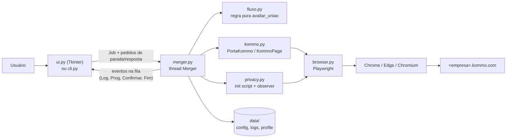

# Kommo — Unir Duplicatas

Aplicativo de desktop para Windows (Python + Tkinter + Playwright) que automatiza o recurso **"Localizar e unir
duplicatas"** do [Kommo](https://www.kommo.com) nas listas de **Leads** e de **Contatos**. Você informa o
subdomínio da conta, o tipo de lista e quantas uniões quer fazer; o app abre o Kommo num navegador real (Chrome,
Edge ou Chromium), espera o seu login e clica em "Unir esta duplicata" uma vez por grupo, conferindo cada
resultado e registrando tudo num log com data e hora.

Projeto independente, sem vínculo com a Kommo.

> [!WARNING]
> **A união de duplicatas no Kommo é IRREVERSÍVEL.** Registros unidos não podem ser separados de novo.
> Antes de qualquer execução real, faça um **ensaio** ("Só simular" na interface ou `--ensaio` no modo texto) e
> depois rode com uma **quantidade pequena** (ex.: 3). Confira o resultado na própria conta antes de aumentar.

## Sumário

- [Problema que resolve](#problema-que-resolve)
- [Funcionalidades](#funcionalidades)
- [Capturas de tela](#capturas-de-tela)
- [Arquitetura resumida](#arquitetura-resumida)
- [Tecnologias](#tecnologias)
- [Requisitos](#requisitos)
- [Instalação no Windows](#instalação-no-windows)
- [Linux (não testado)](#linux-não-testado)
- [Primeira execução](#primeira-execução)
- [Configuração e variáveis de ambiente](#configuração-e-variáveis-de-ambiente)
- [Exemplos de uso](#exemplos-de-uso)
- [Estrutura de pastas](#estrutura-de-pastas)
- [Desenvolvimento](#desenvolvimento)
- [Testes](#testes)
- [Build local](#build-local)
- [Verificador de privacidade](#verificador-de-privacidade)
- [Solução de problemas](#solução-de-problemas)
- [Segurança, privacidade e LGPD](#segurança-privacidade-e-lgpd)
- [Como contribuir](#como-contribuir)
- [Licença](#licença)
- [Limitações conhecidas](#limitações-conhecidas)
- [Documentação](#documentação)

## Problema que resolve

No Kommo, o item "Localizar duplicatas" (menu "⋯" das listas de Leads e de Contatos) abre um modal que mostra
**um grupo de duplicatas por vez**: é preciso clicar em "Unir esta duplicata", esperar a união terminar e só
então aparece o próximo grupo. Com milhares de grupos, fazer isso à mão é inviável. O app repete esse fluxo pela
própria interface do Kommo, com a mesma sessão do usuário, sem usar a API.

## Funcionalidades

- **Leads** ou **Apenas contatos**, cada um com o seu item de menu e a sua URL de lista.
- **Quantidade controlada:** 100 · 200 · 500 · Todas, ou um valor livre (aceita `1.000`; `0` = todas; máximo
  999.999). Valores inválidos são recusados com mensagem, nunca arredondados.
- **Confirmação da conta antes da 1ª união:** um diálogo mostra a conta logada, o tipo, o total informado pelo
  Kommo e a quantidade pedida. Para "Todas" ou mais de 500, o botão "Unir agora" só é liberado depois de digitar
  `UNIR`. No modo texto, a pergunta é `[s/N]` (ou `--sim`).
- **Ensaio** ("Só simular" / `--ensaio`): abre o modal, confere conta, lista e modal e encerra **sem clicar em
  Unir**.
- **Contagem conservadora:** uma união só conta como **confirmada** quando o Kommo mostra o texto de conclusão
  ("…concluída"); as demais ficam como **não confirmadas**. O limite conta **cliques** em "Unir", então nunca
  passa da quantidade pedida.
- **Verificações antes de cada clique:** hostname exato `<empresa>.kommo.com`, caminho coerente com o tipo
  (`/leads` ou `/contacts`) e modal de duplicatas aberto. Se algo não confere, o app encerra sem clicar.
- **PARAR em dois níveis:** o 1º clique para depois da união em andamento; o 2º (FORÇAR PARADA) encerra na hora.
  Fechar a janela durante uma execução pede a parada e espera a união terminar.
- **Tolerância a erros do Kommo:** espera a busca recarregar entre uniões, clica em "Tentar novamente" quando
  aparece "Algo deu errado" e para depois de 3 uniões seguidas sem resultado.
- **Log com data e hora** na tela e em arquivo diário (retenção de 30 dias, linhas sanitizadas).
- **Modo privacidade:** borra no navegador nomes, telefones, e-mails, valores, totais, conta/usuário, chat e o
  modal de duplicatas, e fixa o título da aba em "Kommo"; na janela do app, no terminal (CLI) e no log, mascara
  o subdomínio e os totais.
  Pensado para **gravar a tela** ou apresentar o app.
- **Login salvo:** o perfil do navegador fica em `data/profile/<canal>`; o botão **Esquecer login salvo** apaga.
- **Modo portátil:** configuração, logs e perfil ficam em `data/`, dentro da pasta do programa.
- **Troca de aba durante o login:** se o login/redirecionamento fechar ou substituir a aba do Kommo, o app passa
  a acompanhar outra aba aberta do mesmo navegador; "navegador fechado" só quando **não sobra nenhuma aba**.
- **Modo texto (CLI)** com códigos de saída, para testes e terminal.


## Arquitetura resumida



A interface nunca fala com o navegador: ela cria um `Job`, inicia a thread `Merger` e consome eventos de uma
fila. Tudo que depende do HTML do Kommo está em `kommo.py` (e o que é borrado, em `privacy.py`). Detalhes em
[docs/architecture/arquitetura.md](docs/architecture/arquitetura.md).

## Tecnologias

| Peça | Uso |
|---|---|
| Python 3.10+ (desenvolvimento atual em 3.14; CI testa 3.12, 3.13 e 3.14, todas obrigatórias) | linguagem |
| Tkinter (biblioteca padrão) | interface |
| Playwright (API síncrona; `playwright==1.63.0` no lock) | controle do navegador com perfil persistente |
| PyInstaller (`6.22.3` no lock) | empacotamento em pasta portátil (onedir) |
| pytest (`9.1.1` no lock) | testes |
| ruff (`0.17.0`, fixo no CI) | lint |

## Requisitos

- **Windows 10 ou 11.**
- **Google Chrome ou Microsoft Edge** instalado. Sem eles, o app tenta o Chromium do Playwright, que precisa
  estar instalado à parte (`python -m playwright install chromium`).
- Acesso a uma conta `https://<empresa>.kommo.com` com permissão para unir duplicatas.
- Para rodar do código-fonte: **Python 3.10 ou mais novo**.

## Instalação no Windows

### Pasta portátil (quando houver releases)

Ainda **não há releases publicadas**. Quando houver, o pacote do Windows será uma pasta portátil zipada:

1. Na página de Releases do repositório, baixe `KommoUnirDuplicatas-<versão>-win64.zip` e o `SHA256SUMS.txt`
   da mesma release.
2. Confira o hash (PowerShell) e compare com a linha do arquivo em `SHA256SUMS.txt`:

   ```powershell
   Get-FileHash .\KommoUnirDuplicatas-<versão>-win64.zip -Algorithm SHA256
   ```

3. Extraia para uma pasta **sua** (ex.: Documentos). Evite "Arquivos de Programas": o app precisa gravar em
   `data/` ao lado do executável.
4. Abra `KommoUnirDuplicatas\KommoUnirDuplicatas.exe`.

O executável não é assinado (sem Authenticode): o SmartScreen pode avisar "editor desconhecido" e alguns
antivírus marcam executáveis do PyInstaller como suspeitos. Só prossiga se o hash conferir. Mais detalhes em
[SECURITY.md](SECURITY.md) e [docs/operations/instalacao.md](docs/operations/instalacao.md).

### A partir do código-fonte

Dê dois cliques em `iniciar.bat` (ou rode no terminal). Ele cria o ambiente local `.venv` na primeira vez,
instala as dependências de `requirements.lock` (versões exatas + hashes) e abre o app. Argumentos são repassados
para `main.py`, por exemplo `iniciar.bat --cli acme contatos 3 --ensaio`.

### Quem usava a versão 1.0.0

A versão 1.0.0 guardava perfil, configuração e logs em `%APPDATA%\KommoUnirDuplicatas`. A versão atual usa
`data/` dentro da pasta do programa e **não lê** a pasta antiga: será preciso **entrar no Kommo de novo** e
escolher as preferências outra vez. A pasta antiga pode ser apagada manualmente quando não for mais necessária.

## Linux (não testado)

Existem `iniciar.sh`, `scripts/build_linux.sh` (gera `.tar.gz` portátil e, opcionalmente, AppImage) e
`packaging/linux/`, mas **nada disso foi executado numa máquina Linux real**. O código-fonte precisa de
`python3-venv` e `python3-tk` (Debian/Ubuntu). Veja [packaging/linux/README.md](packaging/linux/README.md) antes
de usar.

## Primeira execução

1. Abra o app (executável, `iniciar.bat` ou `python main.py`).
2. Digite o **subdomínio** (a parte antes de `.kommo.com`), escolha **Leads** ou **Apenas contatos** e a
   quantidade. Para a primeira vez, marque **Só simular (não une nada)**.
3. Clique **SIMULAR** (ou **INICIAR**, sem o ensaio). Na primeira vez, faça login na janela do navegador que
   abrir; o app espera até 10 minutos e continua sozinho.
4. Confira a conta no diálogo de confirmação ("Mostrar conta" revela o subdomínio se o modo privacidade estiver
   ligado) e confirme.
5. Acompanhe o contador e o log. No fim aparece um resumo com confirmadas, não confirmadas, cliques, erros e
   tempo.

Na primeira execução o app cria a pasta de dados:

```
<pasta do programa>/data/
    config.json          preferências (empresa, tipo, limite, privacidade, navegador usado)
    logs/AAAA-MM-DD.log   log diário (apagado após 30 dias)
    profile/<canal>/      perfil do navegador com o login (chrome | msedge | chromium)
    debug/                capturas de diagnóstico (só com KOMMO_DEBUG=1)
```

Em código-fonte, a "pasta do programa" é a raiz do repositório. **`data/` contém os cookies da sessão do Kommo:
não compartilhe, não sincronize e não versione.**

## Configuração e variáveis de ambiente

As preferências da interface ficam em `data/config.json` (gravação atômica; arquivo corrompido é guardado como
`config.json.corrompido` e o app volta ao padrão; um campo com tipo errado volta ao padrão só nele, com aviso no
log). O app não guarda senhas nem tokens.

| Variável | Efeito |
|---|---|
| `KOMMO_DATA_DIR` | muda a raiz de dados. Caminho relativo é resolvido a partir da pasta do programa. Se `data/` não for gravável e a variável não estiver definida, o app mostra o erro e a solução (não cai em outra pasta em silêncio). |
| `KOMMO_BROWSER` | força um navegador: `chrome`, `msedge` ou `chromium`. Valor inválido gera erro. |
| `KOMMO_DEBUG` | `1`, `true`, `yes` ou `on` (sem diferenciar maiúsculas) salvam capturas de tela de diagnóstico em `data/debug/`; `0`, `false` ou vazio não ligam. As capturas podem conter dados de clientes: apague depois. |
| `KOMMO_TERMOS_SENSIVEIS` | termos extras, separados por vírgula, para `scripts/verificar_privacidade.py` (não é lida pelo app). |

## Exemplos de uso

### Interface

```powershell
python main.py
```

Campos: Empresa, tipo (Leads / Apenas contatos), quantidade (100 / 200 / 500 / Todas / "outro valor"), "Modo
privacidade" e "Só simular (não une nada)". Botões: INICIAR (SIMULAR no ensaio), PARAR (FORÇAR PARADA no 2º
clique) e "Esquecer login salvo".

### Modo texto

```powershell
python main.py --cli acme contatos 3 --ensaio        # ensaio: abre e confere, não une nada
python main.py --cli acme contatos 3                 # 3 uniões; pergunta "Confirma? [s/N, m = mostrar a conta]"
python main.py --cli acme leads 10 --sim             # confirma a conta sem perguntar
python main.py --cli acme leads 0 --sem-privacidade  # 0 = todas, sem borrar a tela
```

| Argumento | Significado |
|---|---|
| `empresa` | subdomínio (ex.: `acme`) |
| `leads` \| `contatos` | lista |
| `limite` | quantidade de uniões (inteiro ≥ 0; `0` = todas) |
| `--ensaio` | abre o modal e confere a conta, sem unir |
| `--sim` | confirma a conta automaticamente |
| `--sem-privacidade` | não borra dados sensíveis no navegador e mostra subdomínio/totais em claro no terminal e no log |

Com privacidade (padrão) o terminal e o log mostram a conta como `a***e.kommo.com` e os totais como `••••`; na
pergunta de confirmação, `m` mostra a conta completa só no terminal. Ctrl+C uma vez para depois da união em
andamento; duas vezes força a parada. Códigos de saída: `0` = terminou bem (limite, sem duplicatas ou ensaio,
sem erros); `2` = parado, recusado ou sem resposta; `1` = erro; `64` = erro de uso (argumento inválido).
`python main.py --help` mostra as formas de uso (sem abrir a janela); `python main.py --cli --help`, os
argumentos do modo texto. Na janela, o código de saída do processo é `1` se a pasta de dados não for gravável.

## Estrutura de pastas

```
main.py                       ponto de entrada (código-fonte e executável)
iniciar.bat / iniciar.sh      rodar do código-fonte com .venv local (o .sh não foi testado)
src/kommo_duplicatas/
    __main__.py               sem argumentos → interface; --cli → modo texto; --help → uso
    ui.py                     janela Tkinter, diálogo de confirmação, resumo
    cli.py                    modo texto
    mascara.py                máscaras de privacidade (subdomínio/totais) da janela, do terminal e do log
    merger.py                 motor (thread Merger, Job, eventos)
    fluxo.py                  regra pura de avaliação de cada união
    kommo.py                  URLs, seletores, PortaKommo/KommoPage
    privacy.py                modo privacidade (init script, CSS, observer)
    browser.py                abertura do navegador e perfil por canal
    paths.py                  pasta de dados (modo portátil), esquecer login
    config.py · logs.py       preferências e log diário
    limite.py · temas.py      validação da quantidade; cores e fontes
tests/                        pytest (falsos em tests/fakes.py, fixtures HTML anonimizadas)
scripts/                      build Windows/Linux, empacotamento, locks, verificador de privacidade
packaging/linux/              AppRun e .desktop do AppImage (não testado)
docs/                         documentação (ver abaixo)
.github/                      CI, release, modelos de issue/PR, verificador de links
.vscode/                      launch (F5) e tasks
```

## Desenvolvimento

```powershell
python -m venv .venv
.venv\Scripts\activate
python -m pip install --require-hashes --no-deps -r requirements-dev.lock   # reproduzível
# se o lock não instalar na sua versão do Python:
python -m pip install -r requirements-dev.txt
python -m playwright install chromium     # opcional: testes que rodam o JS no Chromium headless
```

O lock foi gerado com Python 3.14. Para mudar dependências, edite `requirements.in` / `requirements-dev.in` (e o
`.txt` correspondente) e regenere com `scripts\gerar_lock.ps1` (ou `scripts/gerar_lock.sh`); requer internet.

No VS Code:

- **Run and Debug (F5):** "App (interface)"; "CLI — contatos, 3 (ENSAIO, não une nada)", "CLI — leads, 3 (ENSAIO,
  não une nada)" e "CLI — ENSAIO (não une nada)" (todas com `--ensaio`); e, separada, "⚠ CLI — UNIR 3 (REAL,
  irreversível)", que **faz uniões reais** (ainda pergunta `[s/N]` no terminal) — só use com conta de teste.
  Todas as de CLI rodam com `KOMMO_DEBUG=1`.
- **Terminal → Run Task:** "Instalar dependências (dev, .venv)", "Rodar testes", "Build Windows (pasta portátil
  .zip)", "Build Windows (.exe único, alternativo)", "Build Linux (tar.gz + AppImage) — só em Linux", "Verificar
  privacidade (projeto inteiro)", "Verificar privacidade (só dist/)" e "Gerar lock de dependências (requer
  internet)".

Lint (o ruff não está nos `.in`/`.lock`; instale à parte na mesma versão do CI — `pip install ruff==0.17.0` — ou
use o extra `dev` do `pyproject.toml`):

```powershell
ruff check .
```

Convenções, regras de privacidade e processo de PR estão em [CONTRIBUTING.md](CONTRIBUTING.md).

## Testes

```powershell
python -m pytest -q -p no:cacheprovider
python -m pytest -q -p no:cacheprovider --cov      # com cobertura (pytest-cov está no requirements-dev.lock)
```

Resultado na última conferência (14/10/2026, Windows 11, Python 3.14.6): **453 testes aprovados**. Os testes nunca acessam o
Kommo real: o motor é exercitado com `FakeKommo`, `KommoSimulado` e `RelogioFalso` (`tests/fakes.py`); o
JavaScript de estado e de privacidade roda no Chromium headless contra fixtures HTML anonimizadas (esses testes
são pulados se o Chromium do Playwright não estiver instalado). Estratégia e checklist manual em
[docs/testing/estrategia.md](docs/testing/estrategia.md).

## Build local

```powershell
powershell -ExecutionPolicy Bypass -File scripts\build_windows.ps1
```

Usa o `.venv` local (cria se faltar), instala `requirements-dev.lock` com `--require-hashes` e gera em
`dist\windows\`:

- `KommoUnirDuplicatas\` (pasta do programa: `.exe` + `_internal\`);
- `KommoUnirDuplicatas-<versão>-win64.zip` (o que se publica; zip determinístico);
- `SHA256SUMS.txt`.

No fim roda o verificador de privacidade sobre `dist\windows`; se ele achar algo, o build falha. Opções:
`-OneFile` (gera `dist\windows\KommoUnirDuplicatas.exe`, formato antigo; `scripts\build_exe.ps1` faz o mesmo) e
`-SemInstalar` (usa o `.venv` como está). Linux: `bash scripts/build_linux.sh` (não testado). Releases são
montadas pelo workflow `.github/workflows/release.yml` como **rascunho**; ver
[docs/operations/build-distribuicao.md](docs/operations/build-distribuicao.md) e
[docs/operations/ci-cd.md](docs/operations/ci-cd.md).

## Verificador de privacidade

`scripts/verificar_privacidade.py` procura dados da máquina de quem roda (usuário do SO, nome do computador,
pasta home, `git config user.name`/`user.email`) e termos extras em todos os arquivos do projeto e dentro dos
artefatos de build (zip, tar.gz, executáveis do PyInstaller, AppImage). É **fail-closed**: o que não conseguir
ler conta como erro. Saída `0` = limpo; `1` = achados ou erro.

```powershell
python -B scripts/verificar_privacidade.py                         # projeto inteiro
python -B scripts/verificar_privacidade.py --termo minhaempresa    # termo extra (repetível)
python -B scripts/verificar_privacidade.py --somente-dist --dist dist/windows
```

Os termos aparecem mascarados na saída; `--mostrar-termos` mostra em claro (só no seu terminal). Rode antes de
qualquer commit ou publicação.

## Solução de problemas

| Sintoma | O que fazer |
|---|---|
| "Não consigo gravar na pasta de dados do programa" | mova a pasta do programa para um local seu ou defina `KOMMO_DATA_DIR` |
| "O perfil do app … parece estar em uso ou travado" | feche a janela do navegador aberta pelo app (e outras execuções); se persistir, use "Esquecer login salvo" |
| "Não consegui abrir um navegador" | instale Chrome ou Edge, ou `python -m playwright install chromium` |
| Login não confirmado em 10 minutos | entre na conta certa e abra a lista do tipo escolhido; inicie de novo |
| "Algo deu errado" repetido no Kommo | o app tenta de novo e reabre a busca; se persistir, espere alguns minutos |
| Uniões "não confirmadas" em Leads | confira na conta; ver [Limitações conhecidas](#limitações-conhecidas) |

Guia completo: [docs/operations/recuperacao-falhas.md](docs/operations/recuperacao-falhas.md).

## Segurança, privacidade e LGPD

- O app não tem servidor, telemetria nem envia dados a terceiros: fala só com `https://<empresa>.kommo.com`
  pelo navegador.
- Os dados sensíveis ficam na pasta de dados (`data/`): perfil do navegador com os **cookies da sessão**,
  subdomínio na configuração e logs. Com privacidade ligada (padrão, na janela e no modo texto), o subdomínio e
  os totais saem mascarados também no log em arquivo; com ela desligada (`--sem-privacidade` no modo texto),
  aparecem em claro.
- O diagnóstico gravado no log é estrutural (classes, contagens, visibilidade), sem texto de clientes. As
  capturas de `KOMMO_DEBUG` não têm essa garantia.
- O modo privacidade **não é garantia absoluta**: a barra de endereço mostra o subdomínio, e telas não mapeadas
  podem mostrar dados. Confira antes de gravar.
- Quem usa o app opera dados pessoais de clientes no Kommo e responde pelo uso conforme a LGPD e os termos do
  Kommo.

Para relatar vulnerabilidades, siga o [SECURITY.md](SECURITY.md). Análise completa em
[docs/security/seguranca.md](docs/security/seguranca.md).

## Como contribuir

Leia o [CONTRIBUTING.md](CONTRIBUTING.md) e o [CODE_OF_CONDUCT.md](CODE_OF_CONDUCT.md). Em resumo: textos em
português, nada de dados reais em código/testes/issues, testes e verificador de privacidade passando, e
documentação/CHANGELOG atualizados junto com a mudança.

## Licença

O arquivo [LICENSE](LICENSE) traz a licença MIT. A confirmação dessa licença pelo dono do projeto ainda está
pendente.

## Limitações conhecidas

- **Leads:** a confirmação depende do texto de conclusão ("…concluída") no cabeçalho de progresso do Kommo. Esse
  texto foi observado em Contatos; em Leads ainda precisa ser validado. Se não aparecer, as uniões de Leads são
  contadas como "não confirmadas" (o limite continua respeitado, porque conta cliques).
- **Linux:** scripts e empacotamento escritos, mas não testados numa máquina real.
- **Sem assinatura de código** (Authenticode) no executável do Windows.
- **Depende do HTML atual do Kommo:** se a interface mudar, os seletores em `kommo.py` (e `privacy.py`) precisam
  ser ajustados; ver [docs/KOMMO_DOM.md](docs/KOMMO_DOM.md).
- **Domínio fixo** `*.kommo.com`.
- **Releases** ainda não foram publicadas.
- A busca inicial de duplicatas pode levar até cerca de 1 minuto em contas grandes (o app espera até 90 s).

## Documentação

| Documento | Conteúdo |
|---|---|
| [docs/architecture/arquitetura.md](docs/architecture/arquitetura.md) | arquitetura, módulos e fluxo |
| [docs/architecture/jornadas.md](docs/architecture/jornadas.md) | jornadas de uso |
| [docs/architecture/modelo-de-dados.md](docs/architecture/modelo-de-dados.md) | pasta de dados, configuração e eventos |
| [docs/architecture/decisoes/](docs/architecture/decisoes/) | registros de decisões de arquitetura |
| [docs/requirements/funcionais.md](docs/requirements/funcionais.md) | requisitos funcionais |
| [docs/requirements/nao-funcionais.md](docs/requirements/nao-funcionais.md) | requisitos não funcionais |
| [docs/operations/instalacao.md](docs/operations/instalacao.md) | instalação |
| [docs/operations/execucao.md](docs/operations/execucao.md) | execução |
| [docs/operations/build-distribuicao.md](docs/operations/build-distribuicao.md) | build e distribuição |
| [docs/operations/recuperacao-falhas.md](docs/operations/recuperacao-falhas.md) | recuperação de falhas |
| [docs/operations/slo.md](docs/operations/slo.md) | objetivos de nível de serviço |
| [docs/operations/ci-cd.md](docs/operations/ci-cd.md) | CI/CD e releases |
| [docs/testing/estrategia.md](docs/testing/estrategia.md) | estratégia de testes e checklist manual |
| [docs/testing/rastreabilidade.md](docs/testing/rastreabilidade.md) | rastreabilidade requisitos × testes |
| [docs/security/seguranca.md](docs/security/seguranca.md) | segurança e privacidade |
| [docs/KOMMO_DOM.md](docs/KOMMO_DOM.md) | seletores e comportamento observado do Kommo |
| [CHANGELOG.md](CHANGELOG.md) | histórico de mudanças |
| [SECURITY.md](SECURITY.md) · [CONTRIBUTING.md](CONTRIBUTING.md) · [CODE_OF_CONDUCT.md](CODE_OF_CONDUCT.md) | políticas do projeto |
