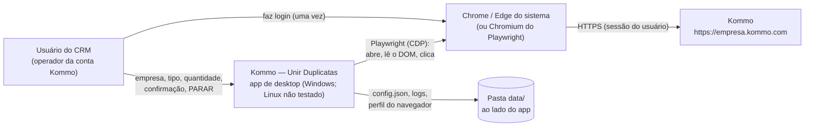
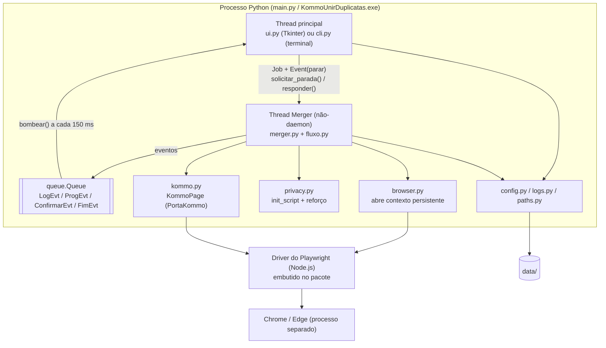
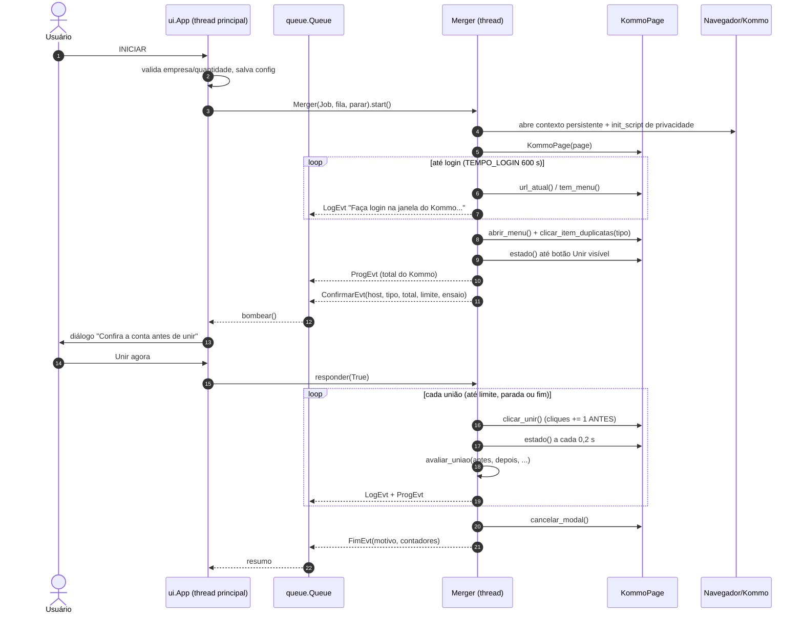
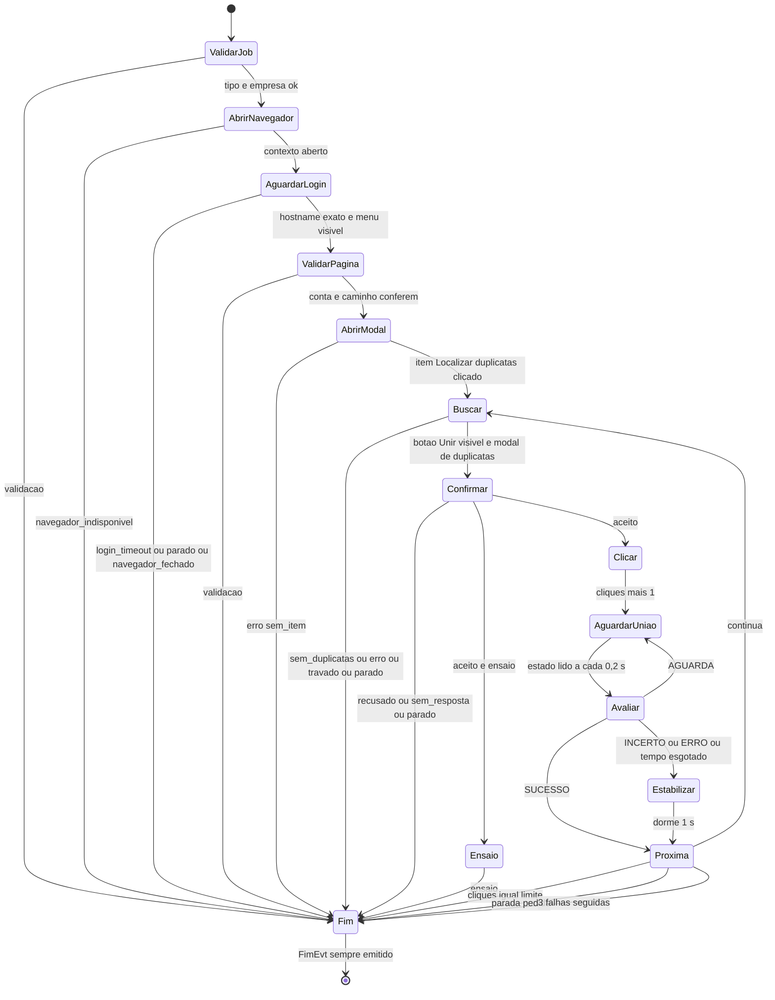

# Arquitetura

> Documento de referência da arquitetura do **Kommo — Unir Duplicatas** (versão do código: `1.0.0`,
> `src/kommo_duplicatas/__init__.py`). Tudo aqui foi conferido no código-fonte atual. Onde algo **não foi
> validado** (Kommo real, Linux, CI no GitHub), isso está dito explicitamente.
>
> Documentos relacionados: [jornadas](jornadas.md) · [modelo de dados](modelo-de-dados.md) ·
> [decisões (ADRs)](decisoes/README.md) · [mapa do DOM do Kommo](../KOMMO_DOM.md) ·
> [requisitos funcionais](../requirements/funcionais.md) · [requisitos não funcionais](../requirements/nao-funcionais.md) ·
> [segurança](../security/seguranca.md) · [estratégia de testes](../testing/estrategia.md) ·
> [CI/CD](../operations/ci-cd.md).

## Sumário

1. [Finalidade](#1-finalidade)
2. [Contexto (C4 níveis 1 e 2)](#2-contexto-c4-níveis-1-e-2)
3. [Módulos e responsabilidades](#3-módulos-e-responsabilidades)
4. [Fluxo de dados e eventos](#4-fluxo-de-dados-e-eventos)
5. [A porta PortaKommo](#5-a-porta-portakommo)
6. [Regra pura de término de uma união](#6-regra-pura-de-término-de-uma-união)
7. [Estados do laço de união](#7-estados-do-laço-de-união)
8. [Motivos de término](#8-motivos-de-término)
9. [Concorrência](#9-concorrência)
10. [Tratamento de erros](#10-tratamento-de-erros)
11. [Privacidade](#11-privacidade)
12. [Portabilidade e dados locais](#12-portabilidade-e-dados-locais)
13. [Segurança (resumo)](#13-segurança-resumo)
14. [Limites e trade-offs](#14-limites-e-trade-offs)
15. [Como evoluir](#15-como-evoluir)

## 1. Finalidade

O Kommo (CRM) tem, no menu "⋯" das listas de **Leads** e de **Contatos**, o item **"Localizar duplicatas"**. Ele
abre um modal que mostra **um grupo de duplicatas por vez**; a pessoa clica em **"Unir esta duplicata"**, espera a
união terminar e só então vê o próximo grupo. Com milhares de grupos, fazer isso à mão é inviável.

O app é um **programa de desktop** (Python + Tkinter + Playwright) que **dirige um navegador real** (Chrome/Edge do
sistema, com o login do próprio usuário) e repete esse fluxo até uma **quantidade pedida** (ou até acabarem as
duplicatas), com:

- **confirmação da conta** antes do primeiro clique (a união é **irreversível**);
- **contagem por cliques** em "Unir" — o limite pedido **nunca é ultrapassado**;
- distinção entre união **confirmada** (o Kommo mostrou o texto de conclusão) e **não confirmada**;
- **modo ensaio** (abre e confere tudo, não une nada);
- **modo privacidade** (borra dados de clientes no navegador e mascara empresa/totais na janela, no terminal e no log);
- **modo portátil** (todos os dados ao lado do programa, em `data/`).

Não há servidor, API própria, banco de dados, telemetria nem atualização automática (ver
[ADR-0011](decisoes/ADR-0011-sem-telemetria-auto-update-sla.md)).

## 2. Contexto (C4 níveis 1 e 2)

### Nível 1 — sistema no seu ambiente

O app **não fala com o Kommo diretamente**: tudo passa pelo navegador, com os cookies da sessão do usuário
guardados no perfil persistente (`data/profile/<canal>/`).

### Nível 2 — contêineres/processos

## 3. Módulos e responsabilidades

Todos em `src/kommo_duplicatas/` (exceto `main.py`).

| Arquivo | Responsabilidade | O que **não** faz |
|---|---|---|
| [`main.py`](../../main.py) | Atalho: põe `src/` no `sys.path` e chama `kommo_duplicatas.__main__.main`. É também o ponto de entrada do PyInstaller. | Não tem lógica. |
| [`__main__.py`](../../src/kommo_duplicatas/__main__.py) | Sem argumentos abre a UI e **propaga** o código de saída dela (`1` = pasta de dados sem escrita); com `--cli` delega para `cli.main(argv[2:])`; `--help`/`-h` mostra o uso sem abrir a janela (ver [modelo de dados §5](modelo-de-dados.md#5-códigos-de-saída)). | Não carrega Tkinter nem Playwright só para mostrar a ajuda. |
| [`__init__.py`](../../src/kommo_duplicatas/__init__.py) | `__version__` e `APP_NOME`. | — |
| [`ui.py`](../../src/kommo_duplicatas/ui.py) | Janela Tkinter: campos, botões INICIAR/SIMULAR e PARAR/FORÇAR PARADA, contador, barra, log, diálogo de confirmação da conta, resumo, "Esquecer login salvo", fechamento seguro. Funções de texto puras (resumo; reexporta as máscaras de `mascara.py`). Consome a fila na thread principal. | Nunca fala com o navegador nem com o Kommo. Não decide nada sobre uniões (só repassa `Job` e respostas). |
| [`cli.py`](../../src/kommo_duplicatas/cli.py) | Modo texto: argumentos (erro de uso → código 64), pergunta `[s/N]` da confirmação (ou `--sim`; com privacidade, `m` mostra a conta), Ctrl+C em 2 níveis, resumo e código de saída. Com privacidade (padrão) mascara terminal e log com `mascara.py` (ver §11). | Não grava `ultimo_total` em `config.json`. |
| [`mascara.py`](../../src/kommo_duplicatas/mascara.py) | Máscaras puras de privacidade para textos: `mascarar_empresa`, `mascarar_host`, `mascarar_mensagem`, `OCULTO`. Usado por `ui.py` e `cli.py`. | Sem I/O, sem Tkinter. Não borra nada no navegador (isso é `privacy.py`). |
| [`merger.py`](../../src/kommo_duplicatas/merger.py) | **Motor.** Thread `Merger` que executa um `Job`: sessão Playwright, espera do login, validações (hostname/caminho/modal), confirmação da conta, abertura do modal, laço de uniões, contadores, `FimEvt` sempre emitido uma vez. | Não lê o DOM diretamente (usa a porta). Não decide o resultado de uma união (usa `fluxo.avaliar_uniao`). Não toca em widgets. |
| [`fluxo.py`](../../src/kommo_duplicatas/fluxo.py) | Regras **puras**: `Resultado` (SUCESSO/INCERTO/AGUARDA/ERRO), `progresso_concluido()`, `avaliar_uniao()`. | Sem I/O, sem tempo, sem Playwright. Não aplica timeout (o motor aplica). |
| [`kommo.py`](../../src/kommo_duplicatas/kommo.py) | Tudo que depende da página: `DOMINIO`, URLs, `Seletores`/`SELETORES` (única fonte dos seletores do fluxo), JS de leitura/ação, `Estado`, `PortaKommo` (Protocol), `KommoPage` (implementação real), `eh_transitorio()`, `normalizar_empresa()`, `hostname_confere()`, `parse_total()`. | Não importa o Playwright (recebe um `page` pronto). Não tem laços nem esperas longas. |
| [`privacy.py`](../../src/kommo_duplicatas/privacy.py) | Modo privacidade no navegador: CSS por seletores + heurísticos, `init_script(ligado)` (MutationObserver, título "Kommo", tooltips, notificações), `aplicar()` (reforço). Mantém `JS_INIT`/`JS_APLICAR` legados. | Não esconde a barra de endereço nem notificações de *push* do service worker. Não mascara a janela do app (isso é `ui.py`). Os seletores do processo vêm de `kommo.SELETORES` (import em nível de módulo; `kommo.py` importa `privacy` só de forma tardia, sem ciclo). |
| [`browser.py`](../../src/kommo_duplicatas/browser.py) | Abre `launch_persistent_context` com o canal certo (Chrome → Edge → Chromium; `KOMMO_BROWSER` força), perfil por canal, detecção de perfil em uso, mensagens claras, `PLAYWRIGHT_BROWSERS_PATH` no `.exe` Windows. Tem `bloquear_navegacao_externa` (desligado). | Não embute navegador. Não tenta outro canal quando o problema é o perfil travado. |
| [`paths.py`](../../src/kommo_duplicatas/paths.py) | Raiz de dados portátil (`app_dir()/data` ou `KOMMO_DATA_DIR`), teste real de escrita, subpastas, `esquecer_login()` seguro (não segue links, não sai da raiz). | Não cai silenciosamente para `%APPDATA%`. |
| [`config.py`](../../src/kommo_duplicatas/config.py) | `config.json`: padrões, validação de tipos por campo (inválido → padrão + aviso), escrita atômica, isolamento de arquivo corrompido (`config.json.corrompido`). | Não guarda senha nem token. Não engole `DataDirNotWritable`. |
| [`logs.py`](../../src/kommo_duplicatas/logs.py) | Log diário `logs/AAAA-MM-DD.log`, sanitização, truncamento, retenção de 30 dias, fail-safe. | Não mascara (quem chama mascara). Não derruba o app se o disco falhar. |
| [`limite.py`](../../src/kommo_duplicatas/limite.py) | Interpretação da quantidade digitada (`parse_limite`), regra de "digitar UNIR" (`exige_digitar`, `LIMITE_EXIGE_DIGITAR = 500`). | Sem Tkinter. |
| [`temas.py`](../../src/kommo_duplicatas/temas.py) | Paleta, fontes por SO, geometria da janela. | Não cria widgets. |

Fora de `src/`: `scripts/` (build, empacotamento, lock, verificador de privacidade), `packaging/linux/`
(AppImage — **não testado**), `.github/workflows/` (CI e release — **nunca executados no GitHub**), `tests/`
(pytest; `tests/fakes.py` com `FakeKommo`, `KommoSimulado`, `RelogioFalso`).

## 4. Fluxo de dados e eventos

A UI (ou a CLI) e o motor conversam **só** por uma `queue.Queue` (motor → UI) e por chamadas de método
thread-safe (UI → motor).

| Direção | Mensagem | Conteúdo / efeito |
|---|---|---|
| UI → motor | `Merger(job, fila, parar)` + `.start()` | `Job(empresa, tipo, limite, privacidade, ensaio, confirmar_conta)` |
| UI → motor | `solicitar_parada(forcar=False)` | 1º pedido: para **entre** uniões. 2º pedido (ou `forcar=True`): aborta na hora. |
| UI → motor | `responder(aceito)` | Resposta ao `ConfirmarEvt` (True continua; False → motivo `recusado`). |
| motor → UI | `LogEvt(nivel, msg)` | `nivel` ∈ `info`, `ok`, `aviso`, `erro`. `erro` incrementa `erros`; `aviso` incrementa `avisos`. |
| motor → UI | `ProgEvt(feitos, limite, total, incertas, cliques)` | `feitos` = uniões **confirmadas**. |
| motor → UI | `ConfirmarEvt(host, tipo, total, limite, ensaio)` | O motor fica **bloqueado** até `responder()`, parada ou `TEMPO_CONFIRMACAO` (600 s). |
| motor → UI | `FimEvt(feitos, segundos, erros, interrompido, total, confirmadas, incertas, cliques, motivo, avisos)` | Emitido **sempre e uma única vez** (no `finally` de `run()`). |

## 5. A porta PortaKommo

`kommo.PortaKommo` é um `typing.Protocol` (`runtime_checkable`) com **tudo** que o motor precisa da página:

`estado()`, `abrir_menu()`, `clicar_item_duplicatas(tipo)`, `clicar_unir()`, `tentar_novamente()`,
`fechar_modal()`, `cancelar_modal()`, `hostname()`, `tem_menu()`, `url_atual()`,
`aplicar_privacidade(on, css)`, `diagnostico()`, `screenshot(path)`, `esta_fechada()`, `paginas_abertas()`,
`adotar_pagina()`.

**Troca de aba (correção T10):** `KommoPage` recebe o `BrowserContext` (`ctx=`) e um gancho `ao_trocar=`
(reaplica os timeouts por aba). Se a aba acompanhada fechar (login que abre/substitui abas, redirecionamento),
`adotar_pagina()` passa a usar outra aba aberta do mesmo contexto — a mais recente em `*.kommo.com`, senão a mais
recente — e `Merger._adotar` registra o aviso no log e reforça a privacidade. `Merger._checar_fechado` só levanta
`NavegadorFechado` quando não resta aba nenhuma, após `GRACA_FECHAMENTO` (3 s, amostragem `POLL_GRACA` 0,5 s).
O modo privacidade é init script **do contexto**, então vale também na aba adotada. Coberto por testes com falsos
(`tests/test_t10_troca_de_aba.py`, `tests/test_kommo_porta.py`, `tests/test_merger.py`; `FakeKommo.outras_paginas`);
**não validado com o login real do Kommo**.

| Implementação | Onde | Uso |
|---|---|---|
| `KommoPage` | `kommo.py` | Real, sobre uma `playwright.sync_api.Page`. Todo `evaluate` tem timeout no lado do JS (`_js_com_timeout`, 5 s; rejeita com `kp-timeout`); cliques usam `page.click(..., timeout=3000)`. Erros transitórios (`eh_transitorio`) **não propagam**: `estado()` devolve `Estado(navegou=True)`, cliques devolvem `False`, leituras devolvem valor seguro. |
| `FakeKommo` | `tests/fakes.py` | Roteiro de `Estado`s (o último se repete), respostas configuráveis, registro de chamadas, `fechado`, `ao_chamar`. |
| `KommoSimulado` | `tests/fakes.py` | Kommo com fases e tempo (busca, erro, grupo, unindo, concluído, navegando, recarga), dirigido por `RelogioFalso`. Simula também o caso pessimista de Leads (`texto_concluido=None`). |

O motor recebe a porta por injeção: `Merger(..., abrir_sessao=...)` aceita uma fábrica de *context manager*
que entrega a porta (padrão: `_sessao_playwright`), e `relogio=` aceita um relógio falso. Assim todo o
`_executar()` roda nos testes **sem navegador e sem `sleep` real** ([ADR-0003](decisoes/ADR-0003-porta-kommo-e-regra-pura.md)).

`Estado` (frozen dataclass) é a leitura do modal num instante: `erro`, `modal`, `caption`, `pode`, `progresso`,
`navegou` — detalhes em [modelo de dados §3](modelo-de-dados.md#3-eventos-e-estruturas-em-memória).

## 6. Regra pura de término de uma união

`fluxo.avaliar_uniao(antes, depois, visto_progresso, ultimo_progresso)` decide o que um clique em "Unir"
produziu. Definições (do docstring):

- **concluído** = `progresso_concluido(depois.progresso)` **ou** `progresso_concluido(ultimo_progresso)`, onde
  `progresso_concluido` procura `/conclu/i` no texto de `h2.progress__header`, ignorando acentos e caixa;
- **visto** = `visto_progresso` ou há texto de progresso em `depois.progresso`/`ultimo_progresso`.

Tabela de decisão (avaliada de cima para baixo; vale a **primeira** linha que casar):

| # | Condição em `depois` | concluído | visto | Resultado |
|---|---|---|---|---|
| 1 | erro no modal (`.js-modal-error`) | – | – | ERRO |
| 2 | navegou (leitura falhou: página recarregando) | sim | – | SUCESSO |
| 3 | navegou | não | – | AGUARDA |
| 4 | progresso ainda visível (inclusive "…concluída") | – | – | AGUARDA |
| 5 | botão Unir visível (próximo grupo; título igual ou diferente — Leads "1 de muitas" repete o título) | sim | – | SUCESSO |
| 6 | botão Unir visível (progresso apareceu e sumiu sem conclusão) | não | sim | INCERTO |
| 7 | botão Unir visível, título diferente do de `antes` | não | não | INCERTO |
| 8 | botão Unir visível, mesmo título (nada mudou ainda) | não | não | AGUARDA |
| 9 | modal fechado (Kommo recarregando a busca) | sim | – | SUCESSO |
| 10 | modal fechado, e `antes` também estava sem modal | não | não | AGUARDA |
| 11 | modal fechado | não | – | INCERTO |
| 12 | qualquer outro caso (modal aberto carregando, sem botão nem progresso) | – | – | AGUARDA |

Princípio: **só há SUCESSO com o texto de conclusão do Kommo e um estado seguinte coerente**. O tempo limite
(`TEMPO_UNIAO` = 120 s) é aplicado pelo motor: AGUARDA por tempo demais vira "sem resultado" (falha) lá.

Como o motor trata cada resultado (`Merger._laco`):

| Resultado | Contador | Conta como falha seguida? | Nível do log |
|---|---|---|---|
| SUCESSO | `confirmadas += 1` (zera falhas) | não | info |
| INCERTO | `incertas += 1` | **não** | aviso |
| ERRO | `incertas += 1` | sim | aviso |
| clique falhou (`clicar_unir()` → False) | `incertas += 1` | sim | aviso |
| `None` (passou de 120 s) | `incertas += 1` | sim (+ diagnóstico) | erro |

Com `FALHAS_MAX = 3` falhas seguidas o motor encerra com motivo `falhas`. Depois de qualquer resultado que não
seja SUCESSO (e se ainda houver o que fazer) o motor dorme `ESTABILIZAR` (1 s) e **reconfere o estado** no topo
do laço antes de qualquer novo clique.

## 7. Estados do laço de união

Observações:

- A **parada normal** e o **limite** só são checados em `Proxima` (topo do laço) e durante a busca — nunca
  durante `AguardarUniao`. A parada **forçada** e o navegador fechado são checados em todos os estados.
- `Buscar` (`_esperar_busca`) é usada ao abrir o modal **e** depois de cada união: clica "Tentar novamente" até
  `ERRO_TENTATIVAS` (5) vezes, reabre pelo menu até `REABERTURAS_MAX` (1) vez por ciclo e, se a página recarregou
  (inclusive durante a união — `navegou_antes`), reabre pelo menu antes de concluir "vazio".
- "Sem duplicatas" só é aceito depois de `_checar_sessao` (hostname exato + caminho do tipo + menu presente);
  senão é `sessao_expirada`.

## 8. Motivos de término

`merger.MOTIVOS` (texto exibido no resumo/log) e o efeito no código de saída da CLI:

| `motivo` | Texto (`MOTIVOS`) | Quando | CLI |
|---|---|---|---|
| `limite` | limite atingido | cliques em Unir == limite | 0 (se `erros == 0`, senão 1) |
| `sem_duplicatas` | sem duplicatas restantes | busca terminou sem grupos, sessão ok, sem erro pendente | 0 (idem) |
| `ensaio` | ensaio (nada unido) | modo ensaio concluído | 0 (idem) |
| `parado` | interrompido pelo usuário | PARAR atendido entre uniões (ou antes do login/da confirmação) | 2 |
| `forcado` | parada forçada pelo usuário | 2º pedido de parada | 2 |
| `recusado` | conta não confirmada (nada unido) | usuário recusou a confirmação | 2 |
| `sem_resposta` | sem resposta à confirmação (nada unido) | ninguém respondeu em 600 s | 2 |
| `sessao_expirada` | sessão do Kommo expirada ou redirecionada | página saiu da lista/conta | 1 |
| `validacao` | conta, página ou modal não conferem | hostname/caminho/modal/job inválidos | 1 |
| `login_timeout` | login não confirmado a tempo | 600 s sem login | 1 |
| `navegador_fechado` | navegador fechado | nenhuma aba aberta no contexto (após 3 s de tolerância); se só a aba acompanhada fechou e há outra, o motor a adota (T10) | 1 |
| `navegador_indisponivel` | navegador indisponível | nenhum canal abriu ou perfil em uso | 1 |
| `falhas` | falhas seguidas | 3 uniões seguidas sem resultado | 1 |
| `erro` | erro | erro persistente do Kommo, item do menu ausente, pasta sem escrita ou erro inesperado | 1 |

A UI grava `ultimo_total`/`ultima_execucao` em `config.json` só para `limite`, `sem_duplicatas` e `parado` com
total > 0 (`ui.MOTIVOS_REGISTRAR`).

## 9. Concorrência

- **Duas threads:** a principal (Tk `mainloop` ou laço da CLI) e a `Merger`, criada com `daemon=False`. Uma
  thread **não-daemon** impede que o interpretador saia no meio de uma união: o processo só termina depois que o
  motor fecha o navegador e emite `FimEvt`.
- **Widgets só na thread principal:** `App.bombear()` drena até 500 eventos a cada 150 ms (`after(150, ...)`).
- **Sincronização no motor:**
  - `parar` (`threading.Event`, compartilhado com a UI; setá-lo direto equivale a `solicitar_parada()`);
  - `_forcar` (`Event`) — parada forçada;
  - `_evt_resposta` (`Event`) + `_trava` (`Lock`) + `_resposta` — confirmação da conta;
  - contadores são atributos de instância escritos só pela thread do motor (a UI só os lê via eventos).
- **Parada em dois níveis:**
  1. **PARAR** (1º clique / 1º Ctrl+C): `parar.set()`. A união em andamento termina (a espera da união não olha
     `parar`); o laço sai no topo com motivo `parado`. O botão vira **FORÇAR PARADA**.
  2. **FORÇAR PARADA** (2º clique / 2º Ctrl+C / `forcar=True`): `_forcar.set()`. Qualquer espera levanta
     `Interrompido(forcado=True)`; o contexto do navegador é fechado no `finally` da sessão; a união pendente
     conta como **não confirmada** (`_contar_pendente`).
- **Fechar a janela** com a thread viva: pergunta, responde NÃO a uma confirmação pendente, pede parada normal,
  espera até `TETO_FECHAR` (150 s), força e espera mais `TETO_FORCAR` (20 s); se ainda viva, avisa e **continua
  esperando** — a janela nunca é destruída com a thread viva.
- **Um `Event` por execução:** `App.iniciar()` cria um `parar` novo; nada é herdado da execução anterior.
- `RelogioFalso` substitui `Relogio` nos testes (inclusive `esperar(evento, s)`), tornando as esperas
  determinísticas.

## 10. Tratamento de erros

| Camada | Mecanismo |
|---|---|
| Leitura do DOM | `KommoPage` engole erros transitórios (`eh_transitorio`): `TimeoutError` ou mensagens com "execution context was destroyed", "target closed", "has been closed", "navigat", "frame was detached", "cannot find context", "kp-timeout". Resultado: `Estado(navegou=True)` / `False` / valor seguro. Outros erros de `estado()` propagam. |
| `Estado.navegou` | Sinaliza "não deu para ler, a página está recarregando". Na regra pura, só vira SUCESSO se a conclusão já foi vista; na busca, marca `houve_nav` e força reabertura pelo menu antes de concluir "vazio". |
| Aba fechada | `_checar_fechado` (em toda espera): se a aba acompanhada fechou, tenta `adotar_pagina()`; sem outra aba, tolera 3 s e só então `NavegadorFechado` (T10). |
| Fluxo | Anomalias saem por exceção `FimDoFluxo(msg, motivo, nivel)` e subclasses `Interrompido`, `SessaoExpirada`, `NavegadorFechado`. |
| `Merger.run()` | `try/except/finally`: `FimDoFluxo` → motivo da exceção; `browser.NavegadorIndisponivel` → `navegador_indisponivel`; `paths.DataDirNotWritable` → `erro`; qualquer outra `Exception` → `navegador_fechado` (se `_eh_fechamento`), "A página do Kommo parou de responder" (se transitório) ou "Erro inesperado: …". O `finally` emite o `FimEvt`. |
| Diagnóstico | `_diagnostico(rotulo)` grava no log um resumo **estrutural** do DOM (contagens de seletores, classes de modais visíveis; **nunca** `textContent`). Captura de tela em `data/debug/<rotulo>.png` só com `KOMMO_DEBUG`. |
| UI | `report_callback_exception` grava o traceback (mascarado) no log e mostra um aviso sem derrubar a janela; `bombear()` protege cada evento; rede de segurança se a thread morrer sem `FimEvt`. |
| Config/logs | `config.json` corrompido → renomeado para `.corrompido` e padrões; log nunca derruba o app (`logs.ultimo_erro`). |
| Pasta de dados | `DataDirNotWritable` herda de `RuntimeError` (não de `OSError`) para não ser engolida por `except OSError`. |

## 11. Privacidade

Três camadas no navegador ([ADR-0007](decisoes/ADR-0007-privacidade-init-script-observer.md)) e uma na janela do
app:

1. **Base — `init_script(ligado)`** registrado com `context.add_init_script` em `Merger._sessao_playwright`.
   Roda em toda navegação, antes dos scripts da página (cobre login e primeira carga). Injeta o CSS
   (`filter: blur(7px)`) via `adoptedStyleSheets`, põe `kp-privacy` no `<html>`, trava `document.title` em
   "Kommo", retira `title` (tooltips) sensíveis para `data-kp-title`, neutraliza `new Notification` e
   `ServiceWorkerRegistration.showNotification` vindos da página e expõe `window.__kpSet(on)` /
   `window.__kpEstado()`.
2. **MutationObserver** (childList, subtree, characterData, atributo `title`) que examina só os nós
   adicionados/alterados e marca `kp-sens` em elementos "folha" (até 2 filhos, texto < 60 caracteres) cujo
   texto casa `REGEX_SENSIVEL` (R$, "N leads/contatos/empresas", %, N/NNN, "limite"). Título, progresso e botões
   do processo nunca são borrados.
3. **Reforço periódico** `Merger._reforcar_privacidade` → `privacy.aplicar(page, True)` no máximo a cada
   `INTERVALO_PRIVACIDADE` (3 s); se o init script não estiver na página, cai no `JS_APLICAR` legado.

Na janela do app (`ui.py`, só com privacidade ligada): subdomínio mascarado (`acme` → `a***e`) no campo Empresa
(fora de edição), no log (tela **e** arquivo), na confirmação (botão "Mostrar conta" revela) e totais da conta
como `••••`. No modo texto (`cli.py`, privacidade padrão; `--sem-privacidade` desliga) a mesma regra
(`mascara.py`) vale para o terminal e o arquivo de log; na pergunta de confirmação, `m` revela a conta só no
terminal.

Também, sempre (com ou sem privacidade), o navegador é aberto com `--disable-notifications` e
`--deny-permission-prompts` (`browser.ARGS_NAVEGADOR`).

**Limites reais:** a barra de endereço mostra `<empresa>.kommo.com`; notificações de *push* do service worker não
passam pelo script; telas/iframes não mapeados podem mostrar dados; com
privacidade **desligada**, `debug/*.png` contém dados de clientes.

## 12. Portabilidade e dados locais

- `paths.app_dir()`: pasta do `.exe` (congelado) ou a raiz do repositório (código-fonte). Nunca o `cwd`.
- Raiz de dados: `KOMMO_DATA_DIR` (relativo → relativo a `app_dir()`) **ou** `app_dir()/data`; testada com
  escrita real (`tempfile.mkstemp`). Sem permissão → `DataDirNotWritable` com instruções; **não** cai para
  `%APPDATA%` ([ADR-0005](decisoes/ADR-0005-modo-portatil-data-ao-lado.md)).
- Perfil **por canal**: `data/profile/chrome`, `data/profile/msedge`, `data/profile/chromium`
  ([ADR-0006](decisoes/ADR-0006-perfil-por-canal-navegador-do-sistema.md)). O canal que abriu é lembrado em
  `config.json` (`canal_navegador`) e tentado primeiro na próxima vez.
- No `.exe` Windows, `browser.configurar_browsers_path()` aponta `PLAYWRIGHT_BROWSERS_PATH` para
  `%LOCALAPPDATA%\ms-playwright` (onde um `playwright install chromium` do usuário ficaria). Isso só importa
  para o *fallback* Chromium.
- AppImage (Linux, **não testado**): `packaging/linux/AppRun` define `KOMMO_DATA_DIR` como
  `<pasta do .AppImage>/KommoUnirDuplicatas-data` porque o AppImage é somente leitura.

Estrutura completa e conteúdo de cada arquivo: [modelo de dados](modelo-de-dados.md).

## 13. Segurança (resumo)

- O app controla um navegador **logado no CRM**; o perfil (`data/profile/`) contém os **cookies da sessão** — é o
  dado mais sensível. Não compartilhe a pasta `data/`.
- Senhas nunca passam pelo app: o login é feito pelo usuário na janela do navegador.
- Antes de cada clique: hostname **exato** `<empresa>.kommo.com` (nunca por substring), caminho `/leads…` ou
  `/contacts…` coerente com o tipo e título do modal contendo "duplicat". Antes do 1º clique: confirmação da
  conta (com digitação de `UNIR` para "todas" ou mais de 500).
- O item do menu é clicado **só** pelo seletor do tipo pedido (sem *fallback* por texto).
- O navegador abre com `chromium_sandbox=True`.
- Build: verificador de privacidade fail-closed ([ADR-0009](decisoes/ADR-0009-verificador-privacidade-fail-closed.md)),
  lock com hashes, sem assinatura de código.

Detalhes, modelo de ameaça e controles: [docs/security/seguranca.md](../security/seguranca.md) e
[SECURITY.md](../../SECURITY.md).

## 14. Limites e trade-offs

| Escolha | Ganho | Custo |
|---|---|---|
| Automação da interface em vez da API | Mesmo comportamento que o usuário teria à mão; sem credenciais de API | Quebra se o Kommo mudar o HTML; lento (uma união por vez, ~2–7 s cada, observado) |
| Confirmação só pelo texto "conclu…" | Nunca conta como feita uma união não confirmada | Em Leads o texto de conclusão **não foi validado**; no pior caso todas ficam "não confirmadas" ([ADR-0004](decisoes/ADR-0004-confirmacao-por-texto-e-contagem-por-cliques.md)) |
| Contagem por cliques | Limite nunca ultrapassado | Pode unir **menos** do que o pedido em casos incertos (cliques que falharam também contam) |
| Parada só entre uniões | Nunca abandona uma união pela metade (no app) | PARAR pode demorar até 120 s; o 2º nível existe para isso |
| Thread não-daemon | Processo não morre no meio de uma união | Fechar a janela pode demorar; um navegador travado exige fechá-lo à mão |
| Modo portátil | Dados visíveis, apagáveis junto com a pasta | Falha em pastas protegidas (Program Files, pendrive somente leitura) |
| Navegador do sistema | Pacote menor, navegador atualizado | Depende de Chrome/Edge instalados e das mudanças deles |
| Sem telemetria/auto-update | Nenhum dado sai da máquina | Correções exigem baixar nova versão manualmente; falhas só são conhecidas se relatadas |
| Domínio fixo `kommo.com` | Validação de hostname simples e estrita | Não funciona com outros domínios (ex.: amoCRM) sem mudar o código |

Limites numéricos (todos em `merger.py`): `TEMPO_UNIAO` 120 s, `TEMPO_BUSCA` 90 s, `TEMPO_LOGIN` 600 s,
`TEMPO_CONFIRMACAO` 600 s, `REAVISO_LOGIN` 60 s, `ERRO_TENTATIVAS` 5, `REABERTURAS_MAX` 1, `FALHAS_MAX` 3,
`POLL_UNIAO` 0,2 s, `POLL_BUSCA` 0,5 s, `POLL_LOGIN` 1,5 s, `ESTABILIZAR` 1 s, `GRACA_FECHAMENTO` 3 s, `INTERVALO_PRIVACIDADE` 3 s,
`TIMEOUT_PAGINA_MS` 15 000, `TIMEOUT_NAVEGACAO_MS` 60 000. Quantidade máxima digitável: 999 999
(`limite.LIMITE_MAXIMO`).

## 15. Como evoluir

### Seletores quebrados (o Kommo mudou o HTML)

1. Sintoma típico: log com "Botão de menu (⋯) não encontrado", "Item 'Localizar duplicatas' não encontrado no
   menu", "A busca de duplicatas não terminou em 90s", ou uniões "sem resultado". A linha
   `Diagnóstico (<rótulo>): …` mostra quantos elementos cada seletor encontrou.
2. Confira no DevTools e atualize **somente** `kommo.Seletores` (Python e JS leem de lá). Se o título/progresso/
   botões mudarem, atualize também as constantes `SEL_*` de `privacy.py` (são cópias).
3. Atualize [`docs/KOMMO_DOM.md`](../KOMMO_DOM.md) e as fixtures `tests/fixtures/*.html` (sem dados reais); rode
   `tests/test_kommo_js.py` e `tests/test_privacy_js.py` (executam o JS no Chromium headless).
4. Teste manual com **ensaio** e depois limite pequeno numa conta de teste.

### Novo tipo de lista (ex.: Empresas)

- `kommo.py`: novo valor em `TIPOS`, URL, campo em `Seletores` + `item()`.
- `merger.py`: `_NOME_TIPO` e `_CAMINHO_TIPO` (validação do caminho).
- `ui.py`/`cli.py`: opção nova; `config.PADRAO` não precisa mudar.
- Verificar a regra de conclusão (`fluxo.progresso_concluido`) com o texto real desse tipo; acrescentar cenário
  em `KommoSimulado`.

### Outro domínio

- `kommo.DOMINIO`, `URL_*`, `normalizar_empresa` (sufixo), `mascara.mascarar_host` (reexportado em `ui`); `browser.url_permitida` usa
  `kommo.com` como padrão. Revisar `hostname_confere` e os testes de hostname.

### Outras evoluções

- Pausar/retomar ou agendar: novos `Event`s no `Merger`, verificados nos mesmos pontos que `parar`.
- Novos eventos para a UI: novo dataclass em `merger.py` e um ramo em `App._tratar`/`cli.main`.
- Mudança na regra de sucesso: só em `fluxo.avaliar_uniao`, com nova linha na tabela e casos em
  `tests/test_fluxo.py`.
