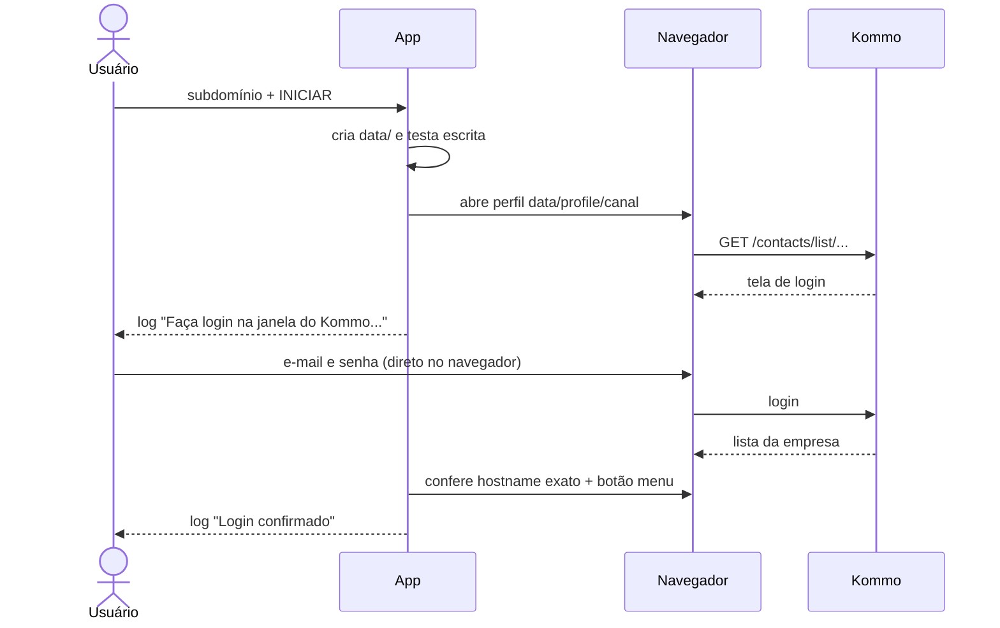
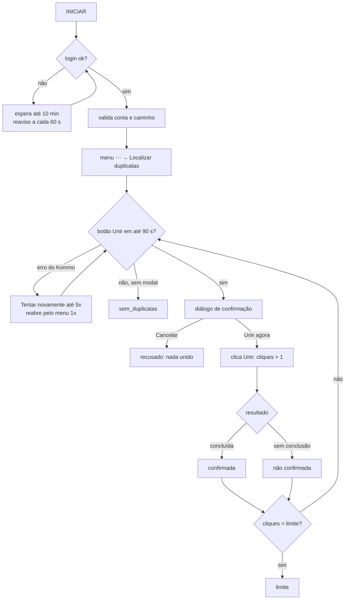
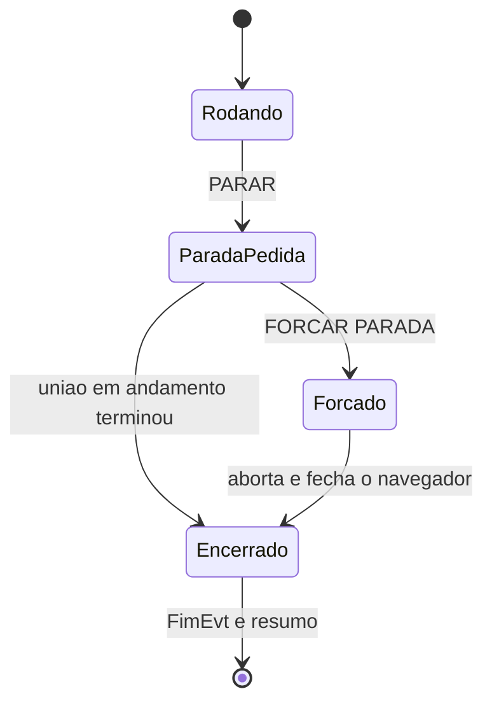
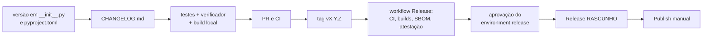

# Jornadas de uso

Jornadas reais do app, descritas a partir do código atual (`ui.py`, `cli.py`, `merger.py`, `browser.py`,
`paths.py`). As mensagens entre aspas são **as mensagens reais** do código (o subdomínio aparece como `<empresa>`
e, com o modo privacidade ligado, a janela mostra `a***e` no lugar dele).

> **Não validado contra o Kommo real nesta documentação.** O comportamento do Kommo (tempos, textos de progresso,
> "Algo deu errado") vem de observação registrada em [KOMMO_DOM.md](../KOMMO_DOM.md) e dos testes com o Kommo
> simulado (`tests/fakes.py`). O texto de conclusão em **Leads** não foi confirmado
> ([ADR-0004](decisoes/ADR-0004-confirmacao-por-texto-e-contagem-por-cliques.md)).

Documentos relacionados: [arquitetura](arquitetura.md) · [modelo de dados](modelo-de-dados.md) ·
[instalação](../operations/instalacao.md) · [execução](../operations/execucao.md) ·
[recuperação de falhas](../operations/recuperacao-falhas.md) · [requisitos funcionais](../requirements/funcionais.md).

## Permissões em geral

| Onde | Permissão |
|---|---|
| Windows | usuário comum; **não** precisa de administrador. Precisa de **escrita** na pasta do programa (ou em `KOMMO_DATA_DIR`). |
| Navegador | Chrome ou Edge instalados (ou o Chromium do Playwright). |
| Kommo | uma conta com acesso à lista (Leads ou Contatos) e ao item "Localizar duplicatas" do menu "⋯". Quais papéis/perfis do Kommo têm esse acesso é definido pelo administrador da conta; o app **não verifica** e isso **não foi levantado**. |
| Rede | acesso HTTPS a `https://<empresa>.kommo.com` (e aos domínios que o Kommo usa no login, ex.: OAuth). |

---

## (a) Primeira execução e login

**Objetivo:** abrir o app pela primeira vez e deixar o login do Kommo salvo no perfil do app.

**Pré-condições:** app extraído numa pasta gravável ([instalação](../operations/instalacao.md)); Chrome ou Edge
instalados; credenciais do Kommo.

**Passos:**

1. Abrir `KommoUnirDuplicatas.exe` (ou `python main.py`). O app cria `data/` e testa a escrita.
2. Digitar o subdomínio (a parte antes de `.kommo.com`; também aceita `empresa.kommo.com` ou a URL completa).
3. Escolher **Leads** ou **Apenas contatos** e a quantidade. Recomendado: marcar **"Só simular (não une nada)"**.
4. Clicar **INICIAR** (ou **SIMULAR**, ou tecla Enter). O log mostra
   "Iniciando: `<empresa>`.kommo.com · Contatos · limite 100".
5. O navegador abre maximizado na lista; o log mostra "Navegador: chrome" e
   "Abrindo a lista de Contatos: https://`<empresa>`.kommo.com/…".
6. Fazer login **na janela do navegador** (o app nunca vê a senha). O log avisa
   "Faça login na janela do Kommo — o app continua sozinho depois." e, a cada 60 s,
   "Ainda aguardando o login (página atual: …). Depois de entrar, abra a lista de Contatos de `<empresa>`.kommo.com."
7. Quando o hostname é **exatamente** `<empresa>.kommo.com` e o botão "⋯" existe: "Login confirmado (…)".
   O app segue sozinho (abre o modal e pede a confirmação — jornadas b/c/d).

**Resultado esperado:** login salvo em `data/profile/<canal>/`; `config.json` com a empresa e o canal do navegador.
Nas próximas execuções o passo 6 é pulado.



**Permissões necessárias:** escrita na pasta do programa; conta do Kommo.

**Cenários alternativos:**

- Login com Google/Facebook: abre abas fora de `kommo.com`; o app **não** as bloqueia
  (`bloquear_navegacao_externa` fica desligado de propósito).
- O usuário entra numa **outra** conta (outro subdomínio): o app continua esperando, porque o hostname não confere.
- O Kommo redireciona Leads para um filtro salvo: aceito, desde que o caminho comece com `/leads`.
- **A aba do Kommo é trocada/fechada durante o login** (ex.: o login abre outra aba ou redireciona e a aba
  original fecha) — **correção T10, já no código** (`KommoPage.adotar_pagina`, `Merger._checar_fechado`):
  o motor passa a acompanhar outra aba aberta do **mesmo** contexto (de preferência a mais recente em
  `*.kommo.com`; senão a mais recente) e registra "A aba do Kommo foi fechada ou substituída; o app passou a
  acompanhar a outra aba aberta (…)." Sem outra aba, espera `GRACA_FECHAMENTO` (3 s) por uma nova antes de
  encerrar com "O navegador foi fechado — execução encerrada." (motivo `navegador_fechado`). A aba adotada passa
  pelas mesmas validações (hostname exato, caminho, modal) antes de qualquer clique. Antes da T10 o app encerrava
  ao fechar a aba inicial, mesmo com outras abertas (falso "navegador fechado"). **Não validado** com o login real
  do Kommo; ver [recuperação de falhas](../operations/recuperacao-falhas.md#o-chrome-fecha-antes-de-eu-logar).

**Mensagens de erro:**

- "Informe o subdomínio da empresa (ex.: minhaempresa)."
- "Empresa inválida: use só o subdomínio, com letras, números e hífen (ex.: minhaempresa ou minhaempresa.kommo.com)."
- Depois de 10 min: "O login no Kommo não foi confirmado em 10 min. Entre na conta `<empresa>`.kommo.com e inicie de novo."
  (motivo `login_timeout`).

**Recuperação:** fazer o login e clicar INICIAR de novo; conferir o subdomínio digitado. Ver também (h), (i), (j).

---

## (b) Unir N leads

**Objetivo:** unir até N grupos de duplicatas de Leads.

**Pré-condições:** login salvo (a); recomendado ter feito um **ensaio** (d) e um teste com limite pequeno (ex.: 3)
conferido na conta.

**Passos:**

1. Empresa, **Leads**, quantidade (100/200/500/Todas ou "outro valor"; `0` = todas).
2. INICIAR. O motor espera o login, confere a conta e o caminho `/leads…`, clica "⋯" → `li.js-duplicate-search`.
3. "Procurando duplicatas — o Kommo pode levar até 90s…". Quando o botão "Unir" aparece:
   "Modal aberto: Localizar e unir duplicatas — 1 de muitas" e, como Leads costuma mostrar "muitas",
   "O Kommo não informou o total de duplicatas (aparece como 'muitas')."
4. Diálogo **"Confira a conta antes de unir"**: Conta, Tipo, Grupos de duplicatas na conta, Quantidade pedida e o
   aviso **"A união é IRREVERSÍVEL"**. "Cancelar" tem o foco; Enter/Esc/X cancelam. Para "Todas" ou mais de 500, é
   preciso digitar **UNIR** para habilitar **"Unir agora"**.
5. Laço: cada clique em "Unir" incrementa `cliques` **antes**; o log registra, uma vez por texto,
   `Kommo (progresso): "…"` e, por união, "União 3/100 confirmada em 5.8s." ou o aviso de não confirmada.
6. Ao atingir a quantidade: "Quantidade pedida atingida." e o resumo.

**Resultado esperado:** resumo com o número de **confirmadas**, as **não confirmadas** (se houver), "N clique(s) em
Unir · limite N" e "Motivo: limite atingido". Contador da janela = confirmadas; a barra = cliques/limite.

**Permissões necessárias:** permissão no Kommo para unir leads.

**Cenários alternativos:**

- **Leads sem texto "concluída"** (risco conhecido): cada união vira "União N/100: o Kommo não confirmou a conclusão
  (…s) — contada como não confirmada; reconferindo a tela antes de seguir." O limite continua sendo respeitado
  (por cliques). Se além disso não aparecer progresso e o título não mudar ("1 de muitas" repetido), cada união
  espera até 120 s e conta como falha; com 3 seguidas, para com "Parando após 3 uniões seguidas sem resultado."
- Acabaram as duplicatas antes do limite: "Nenhuma duplicata restante: concluído." (motivo `sem_duplicatas`).
- O Kommo recarrega a página entre uniões: o app reabre a busca pelo menu antes de concluir que acabou.
- "Algo deu errado": jornada (g).

**Mensagens de erro:** "A página aberta não é a lista de Leads. Encerrado por segurança, sem unir.";
"O modal aberto não é o de 'Localizar e unir duplicatas'. Encerrado por segurança, sem unir.";
"Não encontrei o item 'Localizar duplicatas' no menu (⋯) da lista."; "União N/100: sem resultado em 120s (falha 1/3)."

**Recuperação:** conferir no Kommo (lista de Leads → "Localizar duplicatas") se o número de grupos diminuiu; as
"não confirmadas" **podem ter sido feitas ou não**. Rodar de novo continua de onde o Kommo está (o app não guarda
fila própria).

---

## (c) Unir contatos

**Objetivo:** unir duplicatas de Contatos.

**Pré-condições:** as mesmas de (b).

**Passos:** iguais aos de (b) escolhendo **"Apenas contatos"**. Diferenças reais:

- URL `https://<empresa>.kommo.com/contacts/list/contacts/?skip_filter=Y`; caminho validado `/contacts…`;
  item do menu `li.js-list-duplicate-contacts-search`.
- O Kommo costuma informar o total ("… 1 de 42.761"): o log mostra
  "Total de grupos de duplicatas informado pelo Kommo: 42.761" (com privacidade, `••••` na janela).
- O texto de conclusão observado é "União de contatos concluída com sucesso", que torna a união **confirmada**.

**Resultado esperado:** "União N/limite confirmada em X s." para cada união; resumo "N de TOTAL duplicatas da conta".

**Permissões necessárias:** permissão no Kommo para unir contatos.

**Cenários alternativos / mensagens / recuperação:** como em (b). Em Contatos o limite é atingido normalmente com
todas confirmadas (cenário coberto em `tests/test_merger.py`, com o Kommo simulado).



---

## (d) Ensaio

**Objetivo:** conferir conta, lista e modal **sem unir nada**.

**Pré-condições:** login salvo ou disponível.

**Passos:**

1. Marcar **"Só simular (não une nada)"** (não é salvo: toda abertura começa no modo real). O botão vira
   **▶ SIMULAR**.
2. SIMULAR. Log: "Iniciando: … · ENSAIO (nada será unido)".
3. O motor faz login, validações e abre o modal normalmente.
4. Diálogo **"Confira a conta antes do ensaio"**, aviso **"ENSAIO: nada será unido"**, botão **"Fazer ensaio"**
   (nunca exige digitar UNIR).
5. "Ensaio concluído: conta, lista e modal de duplicatas conferidos. Nada foi unido." e o modal é cancelado.

**Resultado esperado:** "Resumo do ensaio" com "Conta, lista e modal de duplicatas conferidos.", o total de grupos
(se o Kommo informou) e "Nada foi unido (nenhum clique em Unir)." Motivo `ensaio`; CLI devolve 0.

**Permissões necessárias:** acesso de leitura à lista e ao item "Localizar duplicatas" (o modal é aberto).

**Cenários alternativos:** qualquer falha antes do modal gera "O ensaio não chegou ao fim." + o motivo. Se algum
clique em Unir tivesse ocorrido (não deveria), o resumo mostra "Atenção: N clique(s) em Unir — confira no Kommo."

**Mensagens de erro:** as mesmas de validação/login de (a) e (b).

**Recuperação:** corrigir a causa indicada no motivo e repetir o ensaio.

---

## (e) Parar e forçar parada

**Objetivo:** interromper uma execução com segurança.

**Pré-condições:** execução em andamento.

**Passos:**

1. Clicar **■ PARAR** (1º nível). Log: "Parando após a união em andamento…". O botão vira **■ FORÇAR PARADA**.
2. O motor termina a união em andamento (a espera dela **não** olha a parada normal) e sai no topo do laço:
   "Interrompido pelo usuário (depois da união em andamento)." O modal é cancelado (só se não houver progresso na
   tela).
3. Se demorar demais (até 120 s por união), clicar **■ FORÇAR PARADA** (2º nível). Log: "Parada forçada: a união em
   andamento pode ter ficado não confirmada — confira no Kommo." O motor aborta na hora e o navegador é fechado.

**Resultado esperado:** 1º nível → motivo `parado`; 2º nível → motivo `forcado`, com "A união em andamento não
pôde ser confirmada (contada como não confirmada)." Em ambos o resumo aparece e INICIAR é reabilitado.



**Permissões necessárias:** nenhuma.

**Cenários alternativos:**

- PARAR **antes do login** ou **durante a busca/confirmação**: sai imediatamente sem clicar ("Interrompido antes do
  login.", "Interrompido pelo usuário (antes de abrir as duplicatas)." ou "(antes da primeira união)").
- CLI: 1º Ctrl+C "Parando depois da união em andamento… (Ctrl+C de novo força a parada)"; 2º Ctrl+C
  "Forçando a parada…". Código de saída 2.

**Mensagens de erro:** nenhuma específica; a parada é registrada como aviso, não como erro.

**Recuperação:** depois de uma parada **forçada**, conferir no Kommo a última união (pode ter sido feita ou não).

---

## (f) Fechar a janela durante uma união

**Objetivo:** fechar o app sem abandonar uma união pela metade.

**Pré-condições:** thread do motor viva (inclusive esperando login).

**Passos:**

1. Clicar no X da janela. Pergunta: "Há uma união em andamento. Parar e fechar? — O app termina a união em
   andamento antes de fechar." (padrão: **Não**).
2. Respondendo **Sim**: uma confirmação de conta pendente é respondida como NÃO, a parada normal é pedida, os botões
   ficam desabilitados, o título vira "Encerrando…" e o log mostra "Encerrando… a janela fecha sozinha assim que a
   união em andamento terminar."
3. A janela fecha sozinha quando a thread termina (sem diálogo de resumo).

**Resultado esperado:** processo encerrado com o navegador fechado; nenhuma união abandonada pelo app.

**Permissões necessárias:** nenhuma.

**Cenários alternativos:**

- Depois de **150 s** sem terminar: parada forçada automática — "A união em andamento não terminou a tempo; Parada
  forçada: a união em andamento pode ter ficado não confirmada — confira no Kommo."
- Mais **20 s** sem terminar: "O processo ainda não terminou. Feche a janela do navegador aberta pelo app; esta
  janela fecha sozinha em seguida." A janela **nunca** é destruída com a thread viva.
- Respondendo **Não**: nada muda.

**Mensagens de erro:** as acima.

**Recuperação:** se travar, fechar a janela do navegador aberta pelo app; em último caso encerrar o processo no
Gerenciador de Tarefas e conferir a última união no Kommo ([recuperação de falhas](../operations/recuperacao-falhas.md)).

---

## (g) Erro do Kommo "Algo deu errado"

**Objetivo:** atravessar o erro intermitente da busca de duplicatas (observado em Leads com busca demorada).

**Pré-condições:** execução em andamento; o modal mostra `.js-modal-error`.

**Passos (automáticos):**

1. Durante a busca: "Kommo mostrou 'Algo deu errado' — clicando em Tentar novamente (1/5)." até 5 vezes, com 2 s
   de pausa e o prazo de 90 s renovado a cada tentativa.
2. Persistindo: diagnóstico estrutural no log e "Reabrindo a busca de duplicatas pelo menu…" (1 vez por ciclo).
3. Persistindo ainda: "O Kommo continua mostrando 'Algo deu errado'. Tente de novo em alguns minutos." (motivo `erro`).

**Resultado esperado:** na maioria dos casos (observado) a busca volta e o laço continua.

**Permissões necessárias:** nenhuma adicional.

**Cenários alternativos:** o erro aparece **durante** uma união: "União N/L: o Kommo mostrou 'Algo deu errado'
durante a união — contada como não confirmada." (conta como falha seguida; 3 seguidas encerram com motivo
`falhas`).

**Mensagens de erro:** as acima.

**Recuperação:** esperar alguns minutos e iniciar de novo; conferir as "não confirmadas" no Kommo.

---

## (h) Sessão expirada

**Objetivo:** não confundir "sessão caiu" com "acabaram as duplicatas".

**Pré-condições:** a sessão do Kommo expira ou a página é redirecionada durante a execução.

**Passos (automáticos):**

1. A busca termina sem modal. Antes de concluir "sem duplicatas", o motor confere hostname exato, caminho do tipo e
   botão "⋯" (`_checar_sessao`).
2. Se algo não confere: "A sessão do Kommo parece ter expirado ou a página foi redirecionada (página atual: …).
   Nada foi dado como concluído — entre de novo e reinicie." (motivo `sessao_expirada`).
3. Se o hostname mudar **antes de um clique**: "A aba não está na conta `<empresa>`.kommo.com (está em …).
   Encerrado por segurança, sem unir." (motivo `validacao`).

**Resultado esperado:** encerra sem clicar e sem declarar sucesso.

**Permissões necessárias:** nenhuma.

**Cenários alternativos:** o usuário navegou manualmente para outra página do Kommo na janela do app → mesma
validação ("A página aberta não é a lista de …").

**Mensagens de erro:** as acima.

**Recuperação:** iniciar de novo; o app espera o login (a). Não navegue na janela do navegador do app durante a
execução.

---

## (i) Pasta sem permissão de escrita

**Objetivo:** explicar e resolver quando o app está numa pasta protegida.

**Pré-condições:** app em `C:\Program Files\…`, pendrive somente leitura, pasta de rede sem escrita etc.

**Passos:**

1. Abrir o app. `paths.ensure_writable()` falha antes da janela principal.
2. Caixa de erro "Kommo — Unir Duplicatas — pasta de dados" com: "Não consigo gravar na pasta de dados do programa:
   `<caminho>` … Como resolver (escolha um): 1. Mova a pasta do programa para um local seu (ex.: Documentos ou Área
   de Trabalho); ou 2. Defina a variável de ambiente KOMMO_DATA_DIR com uma pasta gravável (ex.:
   C:\Users\<você>\KommoDados) e abra o programa de novo." + "Detalhe técnico".
3. A janela principal **não abre**.

**Resultado esperado:** mensagem clara; nada gravado em outro lugar.

**Permissões necessárias:** escrita na pasta escolhida.

**Cenários alternativos:** a permissão some durante a execução → o motor registra a mensagem acima como erro
(motivo `erro`); o log falha de forma silenciosa (a linha ainda aparece na tela).

**Mensagens de erro:** a de `DataDirNotWritable` acima.

**Recuperação:** mover a pasta inteira para Documentos/Área de Trabalho ou definir `KOMMO_DATA_DIR`
([execução](../operations/execucao.md)).

---

## (j) Navegador não encontrado ou perfil em uso

**Objetivo:** entender por que o navegador não abriu.

**Pré-condições:** nenhum Chrome/Edge/Chromium disponível, ou o perfil do app já está aberto.

**Passos:**

1. INICIAR. `browser.abrir_contexto` tenta, em ordem, o canal lembrado em `config.json` e depois Chrome → Edge →
   Chromium (Windows). `KOMMO_BROWSER` restringe a um só.
2. Canal não instalado: aviso "Navegador 'chrome' indisponível: …" e tenta o próximo.
3. Nenhum abriu: "Não consegui abrir um navegador. Instale o Google Chrome ou o Microsoft Edge (ou rode 'python -m
   playwright install chromium'). Detalhes: …" (motivo `navegador_indisponivel`).
4. Perfil em uso/travado (não tenta outro canal): "O perfil do app para o navegador 'chrome' parece estar em uso ou
   travado: `<caminho>` Feche a janela do navegador aberta pelo app (e outras execuções do app) e tente de novo. Se o
   navegador fechou de forma anormal e o problema continuar, use 'Esquecer login' (será preciso entrar no Kommo de
   novo)."

**Resultado esperado:** mensagem clara; nada é unido.

**Permissões necessárias:** instalar Chrome/Edge pode exigir administrador (fora do app).

**Cenários alternativos:** `KOMMO_BROWSER` com valor errado → "KOMMO_BROWSER='…' não é válido. Use um destes:
chrome, msedge, chromium." O `.exe` não consegue rodar `playwright install` sozinho.

**Mensagens de erro:** as acima.

**Recuperação:** instalar Chrome/Edge; fechar janelas do navegador abertas pelo app (ou outra instância do app);
persistindo, "Esquecer login salvo" (k).

---

## (k) Esquecer login

**Objetivo:** apagar o login salvo (cookies) deste computador.

**Pré-condições:** nenhuma execução em andamento (o botão fica desabilitado durante a execução); navegador do app
fechado.

**Passos:**

1. Clicar **"Esquecer login salvo"** (no cabeçalho do log).
2. Confirmar: "Isto apaga o login salvo do Kommo neste computador. Você precisará entrar de novo. — Continuar?"
   (padrão: Não).
3. `paths.esquecer_login()` apaga o conteúdo de `data/profile/` (todos os canais).

**Resultado esperado:** "Login salvo do Kommo apagado deste computador. Na próxima execução, entre de novo." ou
"Não havia login salvo do Kommo neste computador."

**Permissões necessárias:** escrita em `data/profile/`.

**Cenários alternativos:** arquivo em uso → "Não foi possível esquecer o login: Não consegui apagar todo o login
salvo. Feche a janela do navegador aberta pelo app e tente de novo. Detalhes: …". Pasta `profile` que é link ou
fora da raiz → "Recusei apagar …: não está dentro da pasta de dados …".

**Mensagens de erro:** as acima.

**Recuperação:** fechar o navegador do app e repetir; em último caso apagar `data/profile/` à mão com o app fechado.
Na CLI não há comando equivalente (apague a pasta).

---

## (l) Gravar a tela com o modo privacidade

**Objetivo:** gravar/apresentar o app sem expor dados de clientes.

**Pré-condições:** **"Modo privacidade"** marcado (padrão `true`); gravador de tela pronto.

**Passos:**

1. Conferir que o campo Empresa mostra `a***e` (fora de edição) e que o log mostra o subdomínio mascarado.
2. Iniciar (de preferência em **ensaio** para a gravação).
3. No navegador: linhas da lista, nomes, telefones, e-mails, valores, conta/usuário, chats, campos do modal e
   textos como "9195 leads", "R$ 1.234", "83%" ficam borrados; o título da aba é "Kommo". O título do modal, o
   progresso e os botões continuam legíveis.
4. Diálogo de confirmação: conta e total mascarados; **"Mostrar conta"** revela temporariamente (cuidado durante a
   gravação).
5. Resumo: total da conta como `••••`.

**Resultado esperado:** gravação sem dados de clientes nas áreas mapeadas.

**Permissões necessárias:** nenhuma.

**Cenários alternativos / limites reais:**

- A **barra de endereço** mostra `<empresa>.kommo.com` — corte-a da gravação.
- Notificações de *push* do service worker podem não passar pelo script (o navegador abre com
  `--disable-notifications`, o que mitiga).
- Telas, pop-ups e iframes não mapeados podem mostrar dados. Confira o vídeo inteiro antes de publicar.
- O **modo CLI** segue a mesma regra da janela: com privacidade (padrão) terminal e log saem com o subdomínio
  mascarado e os totais como `••••`; com `--sem-privacidade`, em claro.
- `data/debug/*.png` só existe com `KOMMO_DEBUG`.

**Mensagens de erro:** se o init script não puder ser registrado: "Não foi possível registrar o modo privacidade no
início das páginas (…); usando só o reforço periódico."

**Recuperação:** se algo vazou na gravação, não publique; acrescente o seletor em `privacy.SELETORES` e atualize
[KOMMO_DOM.md](../KOMMO_DOM.md).

---

## (m) Rodar em modo CLI

**Objetivo:** usar o app pelo terminal (testes, automação assistida).

**Pré-condições:** código-fonte com dependências instaladas ([instalação](../operations/instalacao.md)).
Com o `.exe` (`--windowed`) a saída no console **não foi validada**.

**Passos:**

```text
python main.py --cli <empresa> contatos 3
python main.py --cli <empresa> leads 3 --ensaio
python main.py --cli <empresa> contatos 10 --sim
python main.py --cli <empresa> leads 0 --sem-privacidade      (0 = todas)
```

1. O motor imprime cada linha de log (também gravada em `data/logs/`). Com privacidade (padrão) a linha já sai
   mascarada nos dois lugares (subdomínio `a***e`, totais `••••`); `--sem-privacidade` mostra em claro.
2. Antes do 1º clique: "Conta logada: `a***e`.kommo.com · lista: contatos · total informado pelo Kommo: ••••" e
   "Ação: unir até 3 duplicatas — IRREVERSÍVEL" seguido de "Confirma? [s/N, m = mostrar a conta] ". `m` mostra a
   conta e o total em claro **só no terminal** e pergunta de novo. Só `s`, `sim`, `y`, `yes` confirmam;
   vazio/EOF = não. `--sim` confirma sem perguntar. (Sem privacidade a pergunta é "Confirma? [s/N] ".)
3. No fim: "Resumo: N confirmadas, … cliques em Unir, N erros, Ns — limite atingido."

**Resultado esperado:** código de saída 0/1/2, ou 64 para erro de uso
([modelo de dados §5](modelo-de-dados.md#5-códigos-de-saída)).

**Permissões necessárias:** as mesmas da UI.

**Cenários alternativos:** Ctrl+C (e). Argumento inválido → mensagem do `argparse` e código **64** (EX_USAGE; antes era 2, que se confundia com
"parado/recusado") (por exemplo
"quantidade inválida: 'abc' (use um inteiro; 0 = todas)" ou "subdomínio inválido").

**Mensagens de erro:** "O processo terminou sem resumo — confira o log." (código 1).

**Recuperação:** como na UI. Lembre que `--sim` remove a última barreira humana antes de uma ação irreversível.

---

## (n) Publicar uma release (dono do projeto)

**Objetivo:** gerar e publicar uma nova versão nos Releases do GitHub.

**Pré-condições:** acesso de escrita ao repositório e aprovação no environment `release`; configuração do GitHub
descrita em [ci-cd.md](../operations/ci-cd.md). **Nenhum workflow foi executado no GitHub até agora.**

**Passos:**

1. Atualizar a versão em `src/kommo_duplicatas/__init__.py` **e** `pyproject.toml` (devem ser iguais).
2. Acrescentar a seção `## X.Y.Z` no `CHANGELOG.md` (sem ela o workflow falha).
3. Localmente: testes, `python -B scripts/verificar_privacidade.py --termo <sua-empresa>` e o build Windows
   ([build e distribuição](../operations/build-distribuicao.md)).
4. PR → CI verde → merge no `main`.
5. (Opcional) ensaio: *Actions → Release → Run workflow* a partir do `main` (gera artefatos, não cria Release).
6. `git tag vX.Y.Z && git push origin vX.Y.Z`.
7. Aprovar o environment `release` quando pedido.
8. Na página de Releases, abrir o **rascunho**, conferir notas, anexos e `SHA256SUMS.txt`; testar o zip num Windows
   limpo (sem unir contra conta real, ou com limite pequeno numa conta de teste).
9. **Publish release**.



**Resultado esperado:** Release publicado com `KommoUnirDuplicatas-X.Y.Z-win64.zip`, (opcional) `.tar.gz` Linux,
SBOM e `SHA256SUMS.txt`.

**Permissões necessárias:** `contents: write` só no job de rascunho; aprovação manual.

**Cenários alternativos:** tag ≠ `__version__` → "tag … não corresponde à versão do código"; build Linux falha →
rascunho sai só com Windows (job experimental); rascunho já existe → apagar antes de rodar de novo.

**Mensagens de erro:** ver os `::error::` do `release.yml` descritos em [ci-cd.md](../operations/ci-cd.md).

**Recuperação:** apagar o rascunho/tag com problema, corrigir e repetir. Nada é publicado automaticamente.
